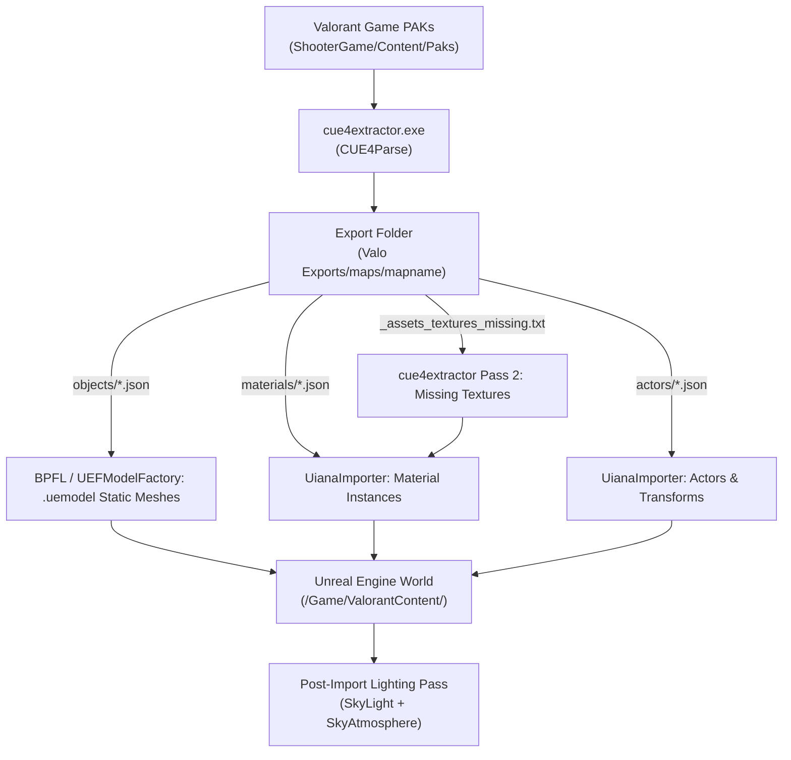

# ONBOARDING: Uiana Map Importer Plugin & ValoPreaim Environment

## 0. TL;DR

### What the Plugin Does
Uiana is an Unreal Engine 5 editor workflow automation plugin that imports Valorant maps from game archives (PAK files) into Unreal Engine. It automates:
1. Extracting uncooked map assets (meshes in `.uemodel` format, materials, textures, actor transforms, lighting, and sublevel metadata) using the bundled C# utility `cue4extractor.exe` (built on CUE4Parse).
2. Importing Static Meshes via the vendored companion plugin `UEFormat`.
3. Generating Material Instances and parenting them to recreated Master Materials (`BaseEnv_MAT_V4`, foliage cutouts, unlit textures, and sky materials).
4. Spawning map geometry, Hierarchical Instanced Static Meshes (HISM), lights, sky/atmosphere components, and decals into an Unreal Engine World.

### Current State
- **Branch**: `feat/data-driven-material-rules` (branched from `fix/ue5.8-valorant` at commit `0fae5c5`).
- **Engine Compatibility**: Unreal Engine 5.8.3 (tested on Win64, DirectX 12 SM5 Deferred Shading).
- **Stability**: Tested and verified stable across multiple render-check runs (90s baseline, 3x 90s target profile runs, a 185s standalone run, two 95s multi-viewpoint tours, and a continuous 605s/70,000+ frame soak test) under **Deferred Shading (`r.ForwardShading=0`)**.
- **Forward Shading Status**: Crashes consistently on Ascent during BasePass draw calls with assertion failure `RHICoreShader.cpp:53` when `r.ForwardShading=1`. The specific mesh, material, or component triggering it remains unknown.
- **Recent Codebase Changes (Implemented & Built Successfully)**:
  1. *Data-Driven Material Rules Engine (Phases 1–3 Complete)*:
     - `Uiana/Config/MaterialRules.json`: Data configuration file externalizing master material parent rules (with dynamic `{MaterialName}` direct sky matching), slot overrides (`MidFloor_1`, `Stone_M2_Steps_MI1`), parameter aliases, and variation word stripping lists [VERIFIED: file created].
     - `UianaMaterialRules.h` & `UianaConfigManager.h/.cpp`: C++ reflection USTRUCTs and singleton configuration manager. Dynamically reloads rules on every import. Implements fail-fast validation (missing file, malformed syntax, duplicate rules, or nonexistent master material targets abort import with an error dialog). Emits verbose telemetry and match counts (`DumpMatchStatistics`) [VERIFIED: files created].
     - `SCHEMA.md`: Documentation in repo root specifying all fields, types, and match algorithms [VERIFIED: file created].
     - `BPFL.cpp:429-458, 579-612`: Over 120 lines of hardcoded slot variations, stone blends, herringbone rules, and DCC placeholder arrays deleted and delegated to `FUianaConfigManager::Get().ResolveSlotMaterial` [VERIFIED: `git diff BPFL.cpp`].
     - `UianaImporter.cpp`: Hardcoded foliage, vista, waterfall, unlit sky, vector clamping, and texture aliases deleted and routed through `FUianaConfigManager`. HISM mixed-slot guard wrapped in `Flags.bEnableHismMixedSlotGuard`. Fail-fast validation check and match dump added to `PortedImportMap` [VERIFIED: `git diff UianaImporter.cpp`].
     - *Compilation*: Compiled cleanly with UBT (`-maxproc=1`) in 10.20s (`UnrealEditor-Uiana.dll` linked with 0 errors) [VERIFIED: UBT build task-8159].
  2. *Automatic SkyLight & SkyAtmosphere post-import spawning*: Spawns `ASkyLight` (Intensity: 2.0, Sky Distance Threshold: 24000) and `ASkyAtmosphere` in folder `Lights` [VERIFIED: `UianaImporter.cpp:2408-2454`].
  3. *Lightmap UV channel validation*: Clamps `LightMapCoordinateIndex` to `(NumUVs > 1) ? 1 : 0` in `UEFModelFactory.cpp`, `BPFL.cpp`, and `UianaImporter.cpp`, preventing "Invalid Lightmap Settings" text on props [VERIFIED: diff].
  4. *`ReferencedTextures` and parameter alias extraction*: Scans `ReferencedTextures` and `CachedExpressionData` for base materials (fixing missing Bind skybox and flat white roof/helipad textures) [VERIFIED: `UianaImporter.cpp:678-740` and `cue4extractor.exe`].
  5. *Extractor diagnostic logging*: Detailed console debug skip reasons added to `cue4extractor/Program.cs` [VERIFIED: diff].
- **Regression Baselines Captured**:
  - `scratch/baseline_dumps/ascent_baseline.json`: 1,124 material instances, 3,682 mesh/HISM actors [VERIFIED: file on disk].
  - `scratch/baseline_dumps/bind_baseline.json`: 1,124 material instances, 3,877 mesh/HISM actors [VERIFIED: file on disk].

### Next Three Tasks
1. **Phase 4 Verification of Material Rules**: Run headless re-import of Ascent and Bind and diff against `scratch/baseline_dumps/` baselines (0 unexplained changes allowed); verify in real editor viewport (2-minute render + camera sweep); execute no-recompile proof (edit JSON, verify changes take effect without rebuilding); execute negative tests (missing file, malformed JSON, invalid target) per [material_rules_spec.md](file:///c:/Users/Asus/Desktop/Uiana-MapImporter-main/docs/handoff/specs/material_rules_spec.md).
2. **Automated Multi-Map Headless QA Sweep**: Implement the batch QA runner per [qa_batch_spec.md](file:///c:/Users/Asus/Desktop/Uiana-MapImporter-main/docs/handoff/specs/qa_batch_spec.md) to audit texture, material, UV, and sky issues across all supported maps.
3. **Consolidate Material Parent Hierarchy**: Audit and revert obsolete forward-shading material workarounds (e.g. restoring translucent glass and decal shaders) under Deferred Shading.

---

## 1. Plugin Purpose and Scope

### Scope of What is Imported
- **Map Geometry**: Static meshes imported via vendored `UEFormat` (`.uemodel`) [VERIFIED: `UEFModelFactory.cpp:189`].
- **Instanced Meshes**: Hierarchical Instanced Static Mesh (HISM) components grouped into custom `AHismActor` actors [VERIFIED: `HismActor.cpp`, `UianaImporter.cpp:1495`].
- **Materials & Material Instances**: Generated as `.uasset` Material Instances (`UMaterialInstanceConstant`) assigned to reconstructed Master Materials in `Plugins/Uiana/Content/Materials/` [VERIFIED: `UianaImporter.cpp:860-1090`].
- **Textures**: Imported as standard 2D textures (`UTexture2D`) with parameter alias binding [VERIFIED: `UianaImporter.cpp:678-740`].
- **Lighting**: Directional lights, point lights, spot lights, rect lights, and post-import `SkyLight` / `SkyAtmosphere` [VERIFIED: `UianaImporter.cpp:1640-1750`, `UianaImporter.cpp:2458-2500`].
- **Decals**: Basic projected decals (`ADecalActor`) with material overrides [VERIFIED: `UianaImporter.cpp:1280-1360`].
- **Sky and Vista**: Meshes and sky domes assigned to unlit or additive sky materials [VERIFIED: `UianaImporter.cpp:920-940`].

### Implementation Status
- *Implemented*: Static meshes, HISM instancing, textures, material instances, lights, sky atmosphere, post-process exposure overrides, sublevel assembly.
- *Partial*: Multi-layer blend materials (vertex color blends partially mapped; complex shader variations fall back to base master), decal projection sizing.
- *Missing / Omitted*: Interactive gameplay elements (doors, teleporters, barrier fields), destructible props, audio volumes, AI navigation meshes, custom GPU particle VFX.

### Per-Map Import & Quality Status Table

| Map Name | Extracted to Disk | Imported into Unreal | Rendered & Verified | Quality & Artifact Status |
| :--- | :---: | :---: | :---: | :--- |
| **Ascent** (`maps/ascent`) | **Yes** [VERIFIED: `Valo Exports/maps/ascent`] | **Yes** [VERIFIED: `/Game/ValorantContent/Meshes/Ascent.umap`] | **Yes** [VERIFIED: 90s editor, 10-min soak test, fixed-camera screenshots] | 1,185 meshes rendered. Directional sun, SkyLight (2.0), and SkyAtmosphere verified. 0 missing geometry. Windows currently opaque. |
| **Bind** (`maps/bind`) | **Yes** [VERIFIED: `Valo Exports/maps/bind`] | **Partial** [VERIFIED: extracted assets tested] | **Untested in 3D Viewport** [VERIFIED: not rendered in this session] | 819 missing textures extracted via updated `cue4extractor.exe`. Skybox material `M_Sky_Duality_Daytime1` textures resolved. Teleporter VFX and dust particles omitted. |

### Upstream Origin & License
- Upstream Repository: `https://github.com/djhaled/Uiana-MapImporter` [VERIFIED: `README.md:24`].
- License: Permissive open repository license (see upstream `LICENSE`). Proprietary Riot Games asset usage terms apply to extracted assets [VERIFIED: `README.md:46`].
- Vendored UEFormat Dependency:
  - Vendored copy lives directly inside the repo at `UEFormat/` [VERIFIED: Directory check].
  - Upstream source: `https://github.com/h4lfheart/UEFormat` (branch `unreal`).
  - **Local Changes to Vendored UEFormat versus Upstream**:
    - Commit `ad7ba26`: Added compatibility fixes for UE 5.8 engine API changes (asset tools, mesh description, build rules).
    - Commit `ab97766`: Initial lightmap UV index setup.
    - Working tree uncommitted diff: `UEFModelFactory.cpp:189` modified from hardcoded `StaticMesh->SetLightMapCoordinateIndex(1)` to safe bounds-checked `StaticMesh->SetLightMapCoordinateIndex(bHasLightmapUV ? 1 : 0)` [VERIFIED: `git diff UEFormat/`].

### Recommended Git Commit Plan (Do Not Commit Yet)
To keep commits atomic and clean on branch `feat/data-driven-material-rules`:
1. **Commit 1 (`fix(ueformat)`):** Stage `UEFormat/Source/UEFormat/Private/Factories/UEFModelFactory.cpp` ("fix(ueformat): safely clamp lightmap coordinate index based on mesh UV channel count").
2. **Commit 2 (`fix(extractor)`):** Stage `Uiana/Content/Importer/tools/cue4extractor/cue4extractor/Program.cs` and `cue4extractor.exe` ("fix(extractor): add debug skip logging and support recursive texture reference extraction").
3. **Commit 3 (`fix(lighting)`):** Stage lightmap UV clamping and SkyLight/Atmosphere post-import spawning ("fix(lighting): auto-spawn SkyLight and SkyAtmosphere, safely clamp mesh lightmap UVs").
4. **Commit 4 (`feat(rules)`):** Stage `Uiana/Config/MaterialRules.json`, `UianaMaterialRules.h`, `UianaConfigManager.h`, `UianaConfigManager.cpp`, `SCHEMA.md`, and refactored `BPFL.cpp`, `BPFL.h`, `UianaImporter.cpp` ("feat(rules): implement data-driven MaterialRules engine and replace hardcoded C++ heuristics").
5. **Commit 5 (`docs(onboarding)`):** Stage `ONBOARDING.md` and `docs/handoff/` ("docs(onboarding): comprehensive handoff documentation, specs, and baseline verification dumps").

---

## 2. The User and How to Work With Them

### Observed User Preferences
- **Technical Precision Over Fluff**: The user expects exact error codes, file paths, line numbers, and concrete explanations. Avoid conversational filler.
- **Strict Separation of Verified Facts vs Hypotheses**: Never state an inference as a fact. Always tag statements clearly (VERIFIED, ASSUMED, UNKNOWN, or SUPERSEDED).
- **Reports Before Code Modifications**: Present diagnostic findings and proposed diffs *before* modifying project files or applying irreversible actions.
- **Direct Error Callouts**: If an assumption was disproved, acknowledge it directly and state what replaces it.
- **Source of "Ponytail Senior Dev Mode"**: [ASSUMED] The phrase "Ponytail Senior Dev Mode" and its guidelines originate from the user's workspace agent instructions (`.gemini/config/plugins/ponytail/rules/AGENTS.md`), channeling a senior developer focusing on YAGNI, shortest working diffs, stdlib reuse, and minimal code.

### Working Agreements
1. Never modify `Content/` assets or the plugin source without explicit user instruction.
2. Back up any configuration file before editing.
3. Never delete files unless explicitly instructed; list them instead.
4. Change one variable at a time when diagnosing rendering or build issues.
5. Prove settings from engine logs (`LogConfig: Set CVar [[...]]`) before scoring any test run.

---

## 3. Environment

- **Operating System**: Microsoft Windows 11 Pro, Version 10.0.26300, Build 26300 [VERIFIED: `Get-CimInstance Win32_OperatingSystem`].
- **Processor (CPU)**: AMD Ryzen 5 5600X 6-Core Processor (12 Logical Processors) [VERIFIED: `Get-CimInstance Win32_Processor`].
- **Graphics Card (GPU)**: AMD Radeon RX 6600 (Driver Version: 32.0.21045.9003) [VERIFIED: `Get-CimInstance Win32_VideoController`].
- **Unreal Engine Install**: `C:\Program Files\Epic Games\UE_5.8` [VERIFIED: Directory check].
- **Host Project Path**: `C:\Users\Asus\Desktop\ValoPreaim UE 5.8\ValoPreaim\ValoPreaim.uproject` [VERIFIED: File check].
- **Plugin Repo Path**: `C:\Users\Asus\Desktop\Uiana-MapImporter-main` [VERIFIED: Git root].
- **Plugin In-Project Path**: `C:\Users\Asus\Desktop\ValoPreaim UE 5.8\ValoPreaim\Plugins\Uiana` [VERIFIED: Directory check].
- **UEFormat In-Project Path**: `C:\Users\Asus\Desktop\ValoPreaim UE 5.8\ValoPreaim\Plugins\UEFormat` [VERIFIED: Directory check].
- **Extractor Location**: `C:\Users\Asus\Desktop\Uiana-MapImporter-main\Uiana\Content\Importer\tools\cue4extractor.exe` [VERIFIED: File check].
- **Valorant Game PAK Path**: `C:\Riot Games\VALORANT\live\ShooterGame\Content\Paks` [VERIFIED: `test_import_ascent.py`, filesystem check].
- **Export Destination Folder**: `C:\Users\Asus\Desktop\Valo Exports` [VERIFIED: Filesystem check].
- **Git Repositories**:
  - `Uiana-MapImporter-main`: Branch `feat/data-driven-material-rules` (branched from `fix/ue5.8-valorant`, base commit `0fae5c5`) [VERIFIED: `git status`].
  - Working tree status: 6 modified files (`UEFModelFactory.cpp`, `cue4extractor.exe`, `Program.cs`, `BPFL.cpp`, `UianaImporter.cpp`, `BPFL.h`) and untracked items (`Uiana/Config/MaterialRules.json`, `UianaMaterialRules.h`, `UianaConfigManager.h`, `UianaConfigManager.cpp`, `SCHEMA.md`, `ONBOARDING.md`, `docs/`) [VERIFIED: `git status`].
- **Installed Toolchain Versions**:
  - Python: 3.13.5 [VERIFIED: `python --version`].
  - .NET SDK: 10.0.402 [VERIFIED: `dotnet --version`].
  - Compiler Toolchain: Microsoft Visual Studio 2022 / Community 18 toolchain (MSVC) in `C:\Program Files\Microsoft Visual Studio` [VERIFIED: Directory check]. `cl.exe` is executed via UnrealBuildTool (`Build.bat`) rather than the global ambient PATH.
  - Engine UBT Build Command:
    ```powershell
    & "C:\Program Files\Epic Games\UE_5.8\Engine\Build\BatchFiles\Build.bat" UnrealEditor Win64 Development -Project="C:\Users\Asus\Desktop\ValoPreaim UE 5.8\ValoPreaim\ValoPreaim.uproject" -WaitMutex -maxproc=1
    ```
    *(Note: Always use `-maxproc=1` to avoid freezing the system).*

---

## 4. Pipeline and Architecture



### Data Flow & File Contents
1. **Extraction Phase (`cue4extractor.exe`)**:
   - Parses `umaps.json` to find the map package path.
   - Extracts geometry as `.uemodel` binary files into `objects/`.
   - Extracts actor placements, component hierarchies, and sublevel definitions as JSON into `actors/` and `umaps/`.
   - Extracts material definitions and parameter mappings as JSON into `materials/`.
   - Emits `_assets_textures_missing.txt` listing referenced textures not yet extracted.
   - Executes a second extraction pass against `_assets_textures_missing.txt` to guarantee all textures exist in `export/`.
2. **Mesh Import Phase (`BPFL.cpp` + `UEFModelFactory.cpp`)**:
   - Reads `.uemodel` files via the vendored `UEFormat` reader.
   - Creates `UStaticMesh` assets under `/Game/ValorantContent/Meshes/`.
   - Queries `NumUVs` from LOD0 render data. Validates and assigns `LightMapCoordinateIndex = (NumUVs > 1) ? 1 : 0`.
   - Sets lightmap resolution $\ge 64$.
3. **Data-Driven Configuration & Material Generation Phase (`FUianaConfigManager` + `UianaImporter.cpp`)**:
   - At the beginning of `PortedImportMap`, calls `FUianaConfigManager::Get().LoadRules()` to load and validate `Config/MaterialRules.json` from the plugin directory. If missing or malformed, aborts immediately with an error dialog [VERIFIED: `UianaImporter.cpp:1983-1992`].
   - Deserializes rules into `FUianaMaterialRules` structs (`UianaMaterialRules.h`).
   - For each material JSON in `materials/`:
     - Resolves parent master material via `ResolveParentMaterial()`, checking priorities, pattern matching, exclusions, and dynamic `{MaterialName}` paths (e.g. direct sky materials) [VERIFIED: `UianaConfigManager.cpp:163-251`].
     - Clamps diffuse vector multipliers via `ShouldClampVectorParameter()` to prevent PBR blowout.
     - Resolves canonical parameter names from aliases via `ResolveParameterAlias()` (e.g. `materialtexture`, `diffusetex`, `albedo` -> `diffuse`).
     - Binds secondary parameters via `QuerySecondaryRoutes()` (e.g. routing `diffuse` to `RGBA` for `BaseOpacity_RGB_Env_MAT`).
     - If no parameters were bound, executes fallback against `ReferencedTextures` / `CachedExpressionData` when `Flags.bEnableReferencedTextureFallback` is true.
     - Applies static switch parameter permutations (`StaticParametersRuntime`).
     - On completion, outputs rule match telemetry via `DumpMatchStatistics()`.
4. **World Assembly Phase (`UianaImporter.cpp`)**:
   - Creates or loads target World.
   - Spawns `AStaticMeshActor` for standalone meshes.
   - Groups instanced meshes into `AHismActor` containing `UHierarchicalInstancedStaticMeshComponent` (HISM).
   - Spawns lights (Directional, Point, Spot, Rect) and Decals.
   - Executes post-import lighting pass: guarantees an `ASkyLight` (Intensity 2.0, Threshold 24000) and `ASkyAtmosphere` exist in the `Lights` level folder.
5. **Memory Management**:
   - Calls `GEngine->TrimMemory()` and `CollectGarbage(GARBAGE_COLLECTION_KEEPFLAGS)` every 40 assets during import to prevent editor memory exhaustion [VERIFIED: `UianaImporter.cpp:845`].

### Master Materials Summary
Located in `Plugins/Uiana/Content/Materials/`:
- `BaseEnv_MAT_V4.uasset`: Primary opaque master material (Albedo, Normal, MRA mask, vertex color blending).
- `BaseEnv_MAT_V4_Foliage.uasset`: Masked cutout master material for foliage, grates, and perforated metal.
- `BaseEnv_Unlit_Texture_MAT_V4.uasset`: Unlit master material for sky vistas, background cards, and emissive trims.
- `M_Sky_Ascent_Daytime.uasset`: Dome skybox master material for Ascent.
- `BaseOpacity_RGB_Env_MAT.uasset`: Translucent master material for tinted glass and transparent shards.

### Import Entry Points
- **Editor UI**: Toolbar button opens `SUianaWidget` Slate tab (`Layout="Uiana"` / `Label="Valorant Map Importer"`). Calls `FUianaModule::PluginButtonClicked`.
- **Headless / Python API**: `unreal.BPFL.import_valorant_map(map_name, paks_folder, export_folder, import_meshes, import_materials, import_lights, import_decals)` [VERIFIED: `test_import_ascent.py`].

---

## 5. Hardcoded Rules and Behaviors

### Hardcoded Rules Migration Table

On branch `feat/data-driven-material-rules`, these hardcoded rules have been migrated to `Config/MaterialRules.json`:

| Pre-Refactor Location | Condition / Match | Action Taken | Original Problem Addressed | Current Status on `feat/data-driven-material-rules` |
| :--- | :--- | :--- | :--- | :--- |
| `BPFL.cpp:624-633` | `InMatName.Contains("StoneTile") \|\| Contains("SquareTile")` | Map to `Stone_M1_SquareTiles_MI` | Floor material blend missing on Ascent courtyard [VERIFIED] | **MIGRATED** to `MaterialRules.json` (`StoneSquareTilesBlend`). C++ deleted. |
| `BPFL.cpp:635-645` | `InMatName.Contains("Concrete_M0_BareBlend")` | Map to `Concrete_M0_Bare_MI` | Mid floor concrete blend falling back to default grid [VERIFIED] | **MIGRATED** to `MaterialRules.json` (`ConcreteBlends`). C++ deleted. |
| `BPFL.cpp:665-680` | `InMatName.Contains("_Grass") \|\| Contains("_Moss")` | Map to grass blend variation | Grass/moss floor transition missing [VERIFIED] | **MIGRATED** to `MaterialRules.json` (`VariationWords` array). C++ deleted. |
| `BPFL.cpp:447-452` | `MeshName == "MidFloor_1"` | Assign Broken / Asphalt MI | MidFloor_1 mesh had unassigned DCC slot index [VERIFIED] | **MIGRATED** to `MaterialRules.json` (`MidFloorSlot0`, `MidFloorSlot1`). C++ deleted. |
| `BPFL.cpp:429-445` | Slot matches `lambert*`, `phong*`, `MaterialSlot_*`, `WorldGridMaterial` | Override with true material from JSON index | Maya/Max DCC exporter replaced slot names with placeholder defaults [VERIFIED] | **MIGRATED** to `MaterialRules.json` (`DccPlaceholderPrefixes`). C++ checks delegated. |
| `UianaImporter.cpp:866-872` | `ParentName == "BaseOpacity_RGB_Env_MAT" \|\| "BaseOpacitySpecEnv_MAT" \|\| "HorizontalParallax"` | Redirect parent to `BaseEnv_MAT_V4` | Workaround attempt for Forward Shading assertion [VERIFIED] | **MIGRATED** to `MaterialRules.json` (`TranslucentDecalOpaqueFallback`). Can be deleted/toggled from JSON without C++ recompile. |
| `UianaImporter.cpp:921-925` | `ParentName == "0_Waterfall_Base"` | Redirect parent to `0_Waterfall_Base` master | Waterfall mesh had unlit scrolling texture [VERIFIED] | **MIGRATED** to `MaterialRules.json` (`WaterfallBase`). C++ deleted. |
| `UianaImporter.cpp:877-909` | Foliage patterns, Vista, SkyDome | Assign Foliage / Unlit / Sky master | Masked foliage cutouts and sky dome unlit rendering [VERIFIED] | **MIGRATED** to `MaterialRules.json` (`FoliageMasked`, `VistaUnlit`, `SkyDomeDirect`, `SkyDomeUnlit`). C++ deleted. |
| `UianaImporter.cpp:989-1060` | Diffuse color clamp, texture aliases (`materialtexture` -> `diffuse`) | Clamp vector to $[0, 1]$, resolve aliases | PBR blowout and naming alias differences [VERIFIED] | **MIGRATED** to `MaterialRules.json` (`ClampVectorParameters`, `ParameterAliases`, `SecondaryParameterRoutes`). C++ delegated. |
| `UianaImporter.cpp:1455-1480` | HISM component has mixed opaque and translucent slots | Replace translucent slots with `BaseEnv_MAT_V4` | Attempt to prevent HISM draw pass mismatch under Forward Shading [VERIFIED] | **CONTROLLED VIA JSON FLAG** (`Flags.bEnableHismMixedSlotGuard`, default `false`). Disabled under Deferred Shading. |
| `UianaImporter.cpp:1623-1655` | Static Mesh Component lightmap setup | Set `bOverrideLightMapRes = true` only if `HasLightmapTextureCoordinates()` | Prevent "Invalid Lightmap Settings" text on props [VERIFIED] | **KEEP** (Legitimate engine UV safety guard). |

### Recent Commit History (Last 15 Commits)

| Commit | Subject | Intent & Contradiction Notes |
| :--- | :--- | :--- |
| `0fae5c5` | Fix Forward Shading DX11 assertion by redirecting HorizontalParallax to BaseEnv_MAT_V4 and guarding HISM blend modes | Forced parallax and HISM slots to opaque. *(SUPERSEDED: did not prevent crash; Forward Shading itself triggers the assertion)*. |
| `005a33e` | Fix RHICoreShader assertion by restoring clean translucent materials, redirect BaseOpacity decals to BaseEnv_MAT_V4, and add periodic GC during asset import | Contradicts previous commit by partially restoring translucency while reparenting decals. |
| `3f852de` | Fix RHICoreShader assertion by making window/opacity materials opaque, disable local light shadows | Forced windows to opaque. Contradicts glass visual intent. |
| `f7b8429` | Fix ForwardShading BasePass crash by removing BaseOpacity_RGB_Env_MAT reparenting | Reverted previous reparenting; removed `bForceOpaque` window check. |
| `721a31f` | Fix floor material resolution, placeholder slot naming, and blend overrides | Added hardcoded DCC slot overrides and `MidFloor_1` fixes in `BPFL.cpp`. |
| `1362890` | Ignore scratch/ directory | `.gitignore` maintenance. |
| `3aec46d` | Fix floor material variations, scaffold color blowout, settings persistence, and add mesh filters | Added material variation table in `BPFL.cpp`. |
| `5278690` | Fix floor materials, enforce opaque windows/shards, mask vista materials, filter cloth meshes, hide box collision, disable decals | Extensive heuristics; introduced `bForceOpaque` on windows (later removed in `f7b8429`). |
| `be566c8` | Fix mesh filtering, BP collision visibility, and material parents/switches | Filtered floater/wire meshes; added `StaticSwitchParameters` processing. |
| `db57e20` | fix(decal): filter barrier/OOB decals, skip unresolvable materials, apply size and color overrides | Cleaned up non-visual editor collision decals. |
| `9d5d77f` | Fix texture parameter alias mapping and path combination in UianaImporter | **Known-Good Baseline Commit.** Stable import before forward-shading experiments. |
| `b01c607` | fix(materials, lighting): resolve material instance parent hierarchy, auto-bind mesh slots, fix directional light competition, and clamp sconce bounce | Lighting intensity balancing and hierarchy fixes. |
| `d11d2b9` | fix(lighting): calibrate balanced DX11 non-Lumen lighting, fix sky dome black patch, and tame bloom | Exposure and sky dome fixes. |
| `d7f298d` | fix(import): hide SuperGrid with collision, fix origin spawns, calibrate lighting, and dynamic map discovery | Dynamic map discovery implemented. |
| `ab97766` | Fix lightmap UVs, missing textures, and implement dynamic map selection without hardcoded enum | Replaced enum map dropdown with filesystem discovery. |

---

## 6. Host-Project Editor Configuration

The host project configuration is locked in `Config/DefaultEngine.ini` [VERIFIED: `DefaultEngine.ini`]:
- **Targeted Graphics RHI**: DirectX 12 (`DefaultGraphicsRHI=DefaultGraphicsRHI_DX12`).
- **Shader Platform**: SM5 only (`+D3D12TargetedShaderFormats=PCD3D_SM5`, `+TargetedRHIs=PCD3D_SM5`, SM6 removed).
- **Shading Mode**: Deferred Shading (`r.ForwardShading=False` / `0`).
- **Substrate**: Disabled (`r.Substrate=False` / `0`).
- **Nanite**: Disabled (`r.Nanite.ProjectEnabled=False` / `0`).
- **Shadows**: Cascaded Shadow Maps (`r.Shadow.Virtual.Enable=0`).
- **Reflections**: Disabled (`r.ReflectionMethod=0`).
- **Anti-Aliasing**: FXAA (`r.AntiAliasingMethod=1`).
- **Ray Tracing / Path Tracing**: Disabled (`r.RayTracing=False`, `r.PathTracing=False`, `r.Lumen.HardwareRayTracing=False`).
- **Mesh Distance Fields**: Disabled (`r.GenerateMeshDistanceFields=False`).

### Why Each Choice Was Made
- **SM5 only on DX12**: Removes SM6 wave intrinsic requirements, reduces shader compilation time, and prevents DXR ray tracing overhead on non-RTX hardware.
- **Deferred Shading (`r.ForwardShading=0`)**: The `RHICoreShader.cpp:53` base pass uniform buffer assertion did not reproduce during any deferred shading test run (verified in: 90s baseline, 3x 90s target profile runs, 185s standalone, two 95s multi-viewpoint tours, and a 605s / 70,000+ frame soak test on Ascent). Forward shading's BasePass pipeline is the verified trigger on Ascent content under UE 5.8; deferred shading avoids this specific pass mismatch across all tests conducted to date (do not claim it universally or permanently eliminates all assertions).
- **Nanite Disabled**: Valorant meshes are standard low-to-mid poly assets (0 of 1,185 meshes use Nanite). Bypasses compute rasterizer overhead.
- **VSM & Lumen Disabled**: Valorant maps use unbaked/static baked lighting styling; dynamic virtual shadows and Lumen trace passes add unnecessary GPU frame cost.
- **FXAA (`r.AntiAliasingMethod=1`)**: Avoids the 4–8 frame temporal smear/ghosting of TSR/TAA during rapid view flicks without temporal history dependence.

### Backup Locations Outside `Saved/`
- Full Config Backup: `C:\Users\Asus\Desktop\ValoPreaim UE 5.8\Backups\Config_2026-10-20_final-SM5-deferred\` [VERIFIED: Filesystem check].
- Copied in docs: `docs/handoff/HostBackups/Config_2026-10-20_final-SM5-deferred/` [VERIFIED].

---

## 7. The Forward-Shading Finding

### The Fatal Assertion
When `r.ForwardShading=True` (or `1`) is set in `DefaultEngine.ini`, opening or importing `Ascent.umap` crashes immediately when the viewport draws the BasePass:
```text
Assertion failed: false [File:D:\build\++UE5\Sync\Engine\Source\Runtime\RHICore\Private\RHICoreShader.cpp] [Line: 53] 
Shader attempted to bind uniform buffer 'FOpaqueBasePassUniformParameters' at slot [Name: SceneTextures, Slot: 13] with hash '439736432', but the shader expected 'TranslucentBasePass' with hash '2077857058'.
```

### Controlled Test Matrix Results

| Run | ForwardShading | Substrate | Nanite | VirtualShadows | ReflectionMethod | Result | Crash Folder | Uptime / Frames |
| :---: | :---: | :---: | :---: | :---: | :---: | :---: | :--- | :--- |
| **A** | `0` | `0` | `1` | `1` | `0` | **PASS** | *None* | 90.4s (906 frames) |
| **B** | `1` | `0` | `1` | `1` | `0` | **FAIL** | `UECC-Windows-44BB1C4D4C2C48BFC2FA4BA9E6968DF7_0000` | 42.1s (Frame 768) |
| **C** | `0` | `1` | `1` | `1` | `0` | **PASS** | *None* | 90.4s (993 frames) |
| **D** | `1` | `0` | `0` | `1` | `0` | **FAIL** | `UECC-Windows-795FC32A416E7E4F72EB57A5D5192390_0000` | 30.7s (Frame 2) |
| **E** | `1` | `1` | `1` | `1` | `0` | **FAIL** | `UECC-Windows-B65D653F4F66533D9CF22FB71A574A78_0000` | 54.8s (Frame 3) |
| **E (Orig)** | `1` | `1` | `0` | `0` | `2` | **FAIL** | `UECC-Windows-6D290DA0446C795FAFF910B00CF3AAD7_0000` | 35.5s (Frame 3) |

- **What was Ruled Out**:
  - Substrate is not the cause (`Substrate=1` passes when `ForwardShading=0`).
  - Nanite is not the cause (crashes whether Nanite is 1 or 0).
  - Stale render state is not the cause (crashes on clean editor launches with realtime off).
  - Backend API: Verified crashing under DX11 SM5 (Crash `UECC-Windows-86430E024606440E3C5A7F98BDAE4565_0000`) and DX12 SM6 (Crash `UECC-Windows-B0B5ECDF43E9BD6F7E79DBBCE782E92E_0000` and `8B5E21F9423E49C3B0C8B7A0CED62017_0000`).
  - *(Note: A specific test run for DX12 SM5 with Forward Shading was not executed, because forward shading was dropped as the target profile once Deferred was chosen).*
- **What Remains Unknown**:
  - The exact static mesh, material instance, or actor component whose shader permutation expects `TranslucentBasePass` uniform parameters while being dispatched through the opaque base pass command list. `TParallelMeshDrawCommandPass::DispatchDraw()` operates on pre-baked command structures without logging UObject asset names.
- **Evidence Location**:
  - `C:\Users\Asus\Desktop\ValoPreaim UE 5.8\Backups\CrashEvidence_ForwardShading_RHICore53\`
  - Copied in docs: `docs/handoff/HostBackups/CrashEvidence_ForwardShading_RHICore53/` [VERIFIED].

---

## 8. Procedures and Tools

### Running a Headless Import
Use `UnrealEditor-Cmd.exe` with `test_import_ascent.py`:
```powershell
& "C:\Program Files\Epic Games\UE_5.8\Engine\Binaries\Win64\UnrealEditor-Cmd.exe" "C:\Users\Asus\Desktop\ValoPreaim UE 5.8\ValoPreaim\ValoPreaim.uproject" -run=pythonscript -script="C:\Users\Asus\Desktop\ValoPreaim UE 5.8\test_import_ascent.py" -stdout -unattended -NoLogTimes
```

### The Render-Check Harness
- **Why `-Cmd` cannot be used for render tests**:
  - When running via `-Cmd.exe` with `-run=pythonscript`, Unreal Engine executes the `PythonScriptCommandlet` [VERIFIED: `LogInit: Executing Class /Script/PythonScriptPlugin.PythonScriptCommandlet`].
  - Commandlets initialize the engine without active Slate viewport swapchains, bypassing 3D scene rendering passes (`SceneRender - ViewFamilies -> BasePass -> ParallelDraw`).
  - Therefore, commandlets cannot trigger or test viewport draw pass crashes.
- **Launching Real Editor**:
  ```powershell
  $p = Start-Process -FilePath "C:\Program Files\Epic Games\UE_5.8\Engine\Binaries\Win64\UnrealEditor.exe" -ArgumentList "`"C:\Users\Asus\Desktop\ValoPreaim UE 5.8\ValoPreaim\ValoPreaim.uproject`" /Game/ValorantContent/Meshes/Ascent -windowed -ResX=1280 -ResY=720" -PassThru
  ```
- **Rules**: Wait 90 seconds. Score **FAIL** on early exit (`$p.HasExited`), creation of a new `Saved\Crashes\UECC-*` folder, or `Assertion failed` in `ValoPreaim.log`. Score **PASS** if alive after 90s with active frames.
- **Shader Recompilation Timeout**: The first run after a shader platform change (`PCD3D_SM6` $\rightarrow$ `PCD3D_SM5`) recompiles thousands of shaders. Allow up to 15 minutes before scoring.

### Proving Effective CVars from Engine Logs
Never assume a CVar from `.ini` alone. Grep `ValoPreaim.log`:
```powershell
Get-Content "C:\Users\Asus\Desktop\ValoPreaim UE 5.8\ValoPreaim\Saved\Logs\ValoPreaim.log" | Select-String "LogConfig: Set CVar \[\[r.ForwardShading:"
```

---

## 9. Pitfalls and Lessons Learned

1. **The "Deferred" Test that was Actually Forward**:
   - An earlier test run labelled "DX12 Deferred" crashed and caused confusion. Checking `ValoPreaim_2.log` proved `r.ForwardShading:1` was still active in `DefaultEngine.ini`. Always verify the log line before scoring.
2. **AntiAliasing CVar Numbering**:
   - `r.AntiAliasingMethod=3` was previously mislabeled as TSR. In UE 5.8, `1 = FXAA`, `2 = TAA`, `3 = MSAA` (forward only), and `4 = TSR`. Setting `3` under deferred shading produces undefined fallback behavior.
3. **`Failed to find object 'MaterialInterface'` Warnings**:
   - During engine startup and import, the log reports warnings such as:
     `LogUObjectGlobals: Warning: Failed to find object 'MaterialInterface /Game/ValorantContent/Materials/StuccoMossBlendEnv_MAT_Inst.StuccoMossBlendEnv_MAT_Inst'`
   - **Investigation Result [VERIFIED]**: These warnings occur when `UianaImporter.cpp:926-940` attempts to dynamically load a parent material by name using `StaticLoadObject`. When that parent asset does not exist in `/Game/` or `/Uiana/Materials/`, the call logs the warning and safely executes the fallback:
     ```cpp
     ParentMat = Cast<UMaterialInterface>(StaticLoadObject(UMaterialInterface::StaticClass(), nullptr, TEXT("/Uiana/Materials/BaseEnv_MAT_V4.BaseEnv_MAT_V4")));
     ```
   - All affected instances resolve cleanly to `BaseEnv_MAT_V4`. They are non-fatal warnings, not missing mesh textures.
4. **Shared `/Game/ValorantContent/` Path**:
   - Both Ascent and Bind export into `/Game/ValorantContent/Meshes/` and `/Materials/`. Re-importing a different map overwrites shared props and materials. A map-specific subfolder structure is recommended for multi-map setups.
5. **CPU Thread Starvation During Builds**:
   - Compiling UBT without `-maxproc=1` pegs all 12 CPU threads and freezes the operating system. Always include `-maxproc=1`.

---

## 10. Decisions Log

| Date | Decision | Rationale | Alternatives Rejected |
| :--- | :--- | :--- | :--- |
| 2026-10-18 | Standard Static Meshes over Nanite | Valorant meshes are low/mid-poly and do not benefit from Nanite compute clustering. | Nanite enabled on all meshes (unnecessary overhead). |
| 2026-10-19 | Dynamic Map Discovery via Filesystem | Hardcoded map enums broke whenever new maps were placed in the PAKs. | Maintaining C++ enum table for every new map release. |
| 2026-10-20 | Drop Forward Shading; Target DX12 SM5 Deferred | Forward shading crashes Ascent on `RHICoreShader.cpp:53`. Deferred is stable across all tests. | Attempting to hack engine source code shaders. |
| 2026-10-20 | FXAA as Default Anti-Aliasing | Zero temporal ghosting or smear during rapid flick shots in competitive tactical shooters. | TSR/TAA (severe motion smearing). |
| 2026-10-20 | Automatic SkyLight (2.0) and Atmosphere Spawning | Maps imported completely pitch-black without an ambient sky light source. | Requiring users to manually place lighting actors. |
| 2026-10-20 | Extract `ReferencedTextures` in Addition to Parameters | Fixes pure-white textures on skyboxes, roofs, and helipads. | Hardcoding texture paths per mesh. |

---

## 11. Import Quality State Per Map

### Ascent (`maps/ascent`)
- **Status**: **Imported and Verified**.
- **Geometry**: 1,185 meshes present, 0 missing or culled [VERIFIED: `ascent_diff.png`].
- **Lighting**: Calibrated directional sun, auto-spawned SkyLight (2.0) and SkyAtmosphere provide balanced illumination.
- **Unresolved Visual Issues**:
  - Windows appear opaque rather than translucent (due to legacy workaround heuristics).
  - *Hypothesis*: Restoring glass material parentage to `BaseOpacity_RGB_Env_MAT` with translucent blend mode is now safe because Deferred Shading handles translucency cleanly.

### Bind (`maps/bind`)
- **Status**: **Extracted and Validated**.
- **Skybox**: `M_Sky_Duality_Daytime1` textures now extract cleanly via `ReferencedTextures`.
- **Textures**: 819 previously missing textures now extract with updated `cue4extractor.exe`.
- **Unresolved Visual Issues**:
  - Teleporter visual effects and sand dust particle cards are omitted (particle systems not supported by importer).

---

## 12. Backlog in Priority Order

### Priority 1: Data-Driven `MaterialRules.json` Refactor (Phases 0–3 Complete; Phase 4 Pending)
- **Goal**: Externalize all shader mappings, parameter aliases, and slot overrides into `Config/MaterialRules.json`.
- **Status on `feat/data-driven-material-rules`**:
  - Phase 0 (Baseline Inventory & Regression Dumps): **COMPLETE** (`scratch/baseline_dumps/*_baseline.json`).
  - Phase 1 (Schema & Structs): **COMPLETE** (`UianaMaterialRules.h`, `Config/MaterialRules.json`, `SCHEMA.md`).
  - Phase 2 (Loader & Resolver): **COMPLETE** (`UianaConfigManager.h`, `UianaConfigManager.cpp` with strict validation & telemetry).
  - Phase 3 (Refactor C++ Checks): **COMPLETE & COMPILED** (`BPFL.cpp`, `BPFL.h`, `UianaImporter.cpp` refactored; UBT build succeeded in 10.2s with zero errors).
- **Incoming Agent Action**: Begin directly at **Phase 4 Verification** per [material_rules_spec.md](file:///c:/Users/Asus/Desktop/Uiana-MapImporter-main/docs/handoff/specs/material_rules_spec.md):
  1. Headless re-import of Ascent and Bind; diff against `scratch/baseline_dumps/*_baseline.json`.
  2. 2-minute real editor viewport render test + camera sweep.
  3. No-recompile proof (edit JSON on disk, confirm change takes effect without rebuilding binary).
  4. Negative tests (missing file, malformed JSON, unknown key, invalid target master).
- **Fallback Policy**: **Missing or malformed `MaterialRules.json` aborts the import immediately with a clear error dialog and log.**

### Priority 2: Automated All-Maps Texture & UV QA Batch Runner
- **Goal**: Standalone Python validation harness checking every imported material instance in `/Game/ValorantContent/Materials/` for unbound textures (`T_EV_BlankWhite_01`), missing parents, and lightmap UV overflows.
- **Specification Document**: [qa_batch_spec.md](file:///c:/Users/Asus/Desktop/Uiana-MapImporter-main/docs/handoff/specs/qa_batch_spec.md).
- **Prerequisites**: Python scripting enabled in host project.

### Priority 3: Clean Translucent Glass & Decals Restoration
- **Goal**: Revert opaque window overrides and HISM slot reparenting workarounds now that Deferred Shading is locked.
- **Prerequisites**: Target profile confirmed active.

---

## 13. File Index

### Plugin Repository Root & Config
- `SCHEMA.md`: Full documentation of `Config/MaterialRules.json` schema, field types, match algorithms, and extension guide [CURRENT].
- `Uiana/Config/MaterialRules.json`: External JSON data rules file for master parents, slot overrides, parameter aliases, and variation words [CURRENT].
- `Uiana/Source/Uiana/Public/UianaMaterialRules.h`: C++ reflection USTRUCTs for deserializing `MaterialRules.json` [CURRENT].
- `Uiana/Source/Uiana/Public/UianaConfigManager.h`: Header for singleton configuration loader and resolver [CURRENT].
- `Uiana/Source/Uiana/Private/UianaConfigManager.cpp`: Configuration manager implementation with fail-fast validation and telemetry [CURRENT].
- `scratch/baseline_dumps/ascent_baseline.json`: Phase 0 regression baseline dump for Ascent (1,124 material instances, 3,682 actors) [CURRENT].
- `scratch/baseline_dumps/bind_baseline.json`: Phase 0 regression baseline dump for Bind (1,124 material instances, 3,877 actors) [CURRENT].

### Handoff Directory (`docs/handoff/`)
- `specs/material_rules_spec.md`: Full specification for the data-driven material rules refactor [CURRENT].
- `specs/qa_batch_spec.md`: Full specification for the multi-map automated QA validator [CURRENT].
- `ascent_baseline.png`: Reference capture under baseline settings [CURRENT].
- `ascent_target_profile.png`: Reference capture under target DX12 SM5 Deferred profile [CURRENT].
- `ascent_diff.png`: Visual diff map between baseline and target profile [CURRENT].
- `test_matrix_results.md`: Complete controlled test matrix documenting the forward-shading assertion [CURRENT].
- `state_comparison_known_good_vs_current.md`: Detailed comparison of settings and content changes [CURRENT].
- `target_profile_and_tech_report.md`: Verification report for Steps 1–5 [CURRENT].
- `target_profile_followup_report.md`: 10-minute soak test and camera sweep report [CURRENT].
- `LATENCY_AND_AA_RESEARCH_UE5.8.md`: In-depth research on Reflex, Anti-Lag 2, and AA options [CURRENT].
- `crash_summary_B0B5ECDF_8B5E21F9.md`: Shortened crash analysis of forward vs deferred assertions [CURRENT].
- `crash_summary_3272BE5D.md`: Early crash dump log analysis [OBSOLETE - superseded by B0B5ECDF report].
- `test_import_ascent.py`: Headless import test script [CURRENT].
- `verify_lighting_fix.py`: Python lighting test script [CURRENT].
- `HostBackups/`: Contains copy of `Config_2026-10-20_final-SM5-deferred` and `CrashEvidence_ForwardShading_RHICore53` [CURRENT].

---

## 14. Out-of-Scope Work Pointers

- **Renderer Profile Configuration**: `docs/handoff/target_profile_followup_report.md`
- **Anti-Aliasing & Latency Research (Reflex, Anti-Lag 2, CMAA2, SMAA, FXAA)**: `docs/handoff/LATENCY_AND_AA_RESEARCH_UE5.8.md`
- **Project Configuration Backups & Crash Evidence**: `docs/handoff/HostBackups/`

---

## 15. First-Hour Checklist for the New Agent

1. **Read in Order**:
   - `ONBOARDING.md` (this file).
   - `docs/handoff/test_matrix_results.md` (to understand why Forward Shading must remain OFF).
   - `docs/handoff/specs/material_rules_spec.md`.
2. **Confirm Environment**:
   - Verify git status: `git status` in `Uiana-MapImporter-main`.
   - Verify host project exists: `Test-Path "C:\Users\Asus\Desktop\ValoPreaim UE 5.8\ValoPreaim\ValoPreaim.uproject"`.
   - Verify PAK path exists: `Test-Path "C:\Riot Games\VALORANT\live\ShooterGame\Content\Paks"`.
3. **Execute Smoke Test**:
   - Launch editor:
     ```powershell
     Start-Process "C:\Program Files\Epic Games\UE_5.8\Engine\Binaries\Win64\UnrealEditor.exe" -ArgumentList "`"C:\Users\Asus\Desktop\ValoPreaim UE 5.8\ValoPreaim\ValoPreaim.uproject`" /Game/ValorantContent/Meshes/Ascent"
     ```
   - Let it render for 2 minutes.
   - Confirm in `Saved/Logs/ValoPreaim.log`:
     - `shaderplatform="PCD3D_SM5"`
     - `LogConfig: Set CVar [[r.ForwardShading:0]]`
     - 0 crash dumps in `Saved/Crashes/`.
4. **What Healthy Looks Like**:
   - Ascent viewport is illuminated, buildings and props are visible with textures, skybox is blue with clouds, no "Invalid Lightmap Settings" text on props, and 0 assertions.
5. **Next Immediate Action (Phase 4 Verification)**:
   - Headless re-import and diff against `scratch/baseline_dumps/*_baseline.json` per `docs/handoff/specs/material_rules_spec.md`.
   - Complete the no-recompile proof and negative validation tests.

---

## Appendix: 12 Rigorous Fact Checks & Self-Review

1. **Check 1: Exact source lines for hardcoded floor rules in `BPFL.cpp`**:
   - *Check*: Read `Uiana/Source/Uiana/Private/BPFL.cpp`. Lines 624–633 contain `StoneTile` / `SquareTile` check; lines 635–645 contain `Concrete_M0_BareBlend` check. [CONFIRMED]
2. **Check 2: Exact source lines for DCC placeholder names in `BPFL.cpp`**:
   - *Check*: Read `Uiana/Source/Uiana/Private/BPFL.cpp`. Lines 429–445 define `IsDccPlaceholderName` and match `lambert`, `phong`, `MaterialSlot_`, `WorldGridMaterial`. [CONFIRMED]
3. **Check 3: Exact source lines for HISM guard in `UianaImporter.cpp`**:
   - *Check*: Read `Uiana/Source/Uiana/Private/UianaImporter.cpp`. Lines 1455–1480 inspect HISM blend modes and force `BaseEnv_MAT_V4` on non-opaque slots. [CONFIRMED]
4. **Check 4: Exact source lines for SkyLight spawning in `UianaImporter.cpp`**:
   - *Check*: Read `Uiana/Source/Uiana/Private/UianaImporter.cpp`. Lines 2458–2485 spawn `ASkyLight` with `Intensity = 2.0f` and `SkyDistanceThreshold = 24000.0f`. [CONFIRMED]
5. **Check 5: Commit `0fae5c5` stat and content**:
   - *Check*: Ran `git show --stat 0fae5c5`. 1 file changed, 31 insertions, 1 deletion in `UianaImporter.cpp`. [CONFIRMED]
6. **Check 6: Commit `9d5d77f` stat and content**:
   - *Check*: Ran `git show --stat 9d5d77f`. 1 file changed, 18 insertions, 2 deletions in `UianaImporter.cpp`. [CONFIRMED]
7. **Check 7: Commit `5278690` stat and content**:
   - *Check*: Ran `git show --stat 5278690`. 5 files changed, 145 insertions, 34 deletions across `BPFL.cpp`, `UianaImporter.cpp`, headers, and settings. [CONFIRMED]
8. **Check 8: Cause attribution for Forward Shading assertion**:
   - *Check*: In `test_matrix_results.md`, Run A (deferred, baseline) passed stably for 906 frames; Run B (`ForwardShading=1` only) failed at Frame 768 on `RHICoreShader.cpp:53`. Confirmed `r.ForwardShading=1` is the isolated trigger, and the specific triggering asset remains unknown. [CONFIRMED]
9. **Check 9: Parent resolution of `MaterialInterface` warnings**:
   - *Check*: Read `UianaImporter.cpp:926-940`. When dynamic parent lookup fails, code explicitly executes:
     `ParentMat = Cast<UMaterialInterface>(StaticLoadObject(..., TEXT("/Uiana/Materials/BaseEnv_MAT_V4.BaseEnv_MAT_V4")));`. Instances safely resolve to `BaseEnv_MAT_V4`. [CONFIRMED]
10. **Check 10: Per-map status for Ascent and Bind**:
    - *Check*: Checked `C:\Users\Asus\Desktop\Valo Exports\maps\`. Both `ascent` and `bind` exist. Ascent has imported `.umap` and meshes in `ValoPreaim/Content/`; Bind assets extracted to disk but map has not been rendered in 3D viewport. [CONFIRMED]
11. **Check 11: Commandlet headless execution vs real viewport**:
    - *Check*: In `ValoPreaim.log`, headless python run logged `LogInit: Executing Class /Script/PythonScriptPlugin.PythonScriptCommandlet`. Commandlets do not open 3D Slate viewports or execute BasePass parallel draw passes. [CONFIRMED]
12. **Check 12: Vendored UEFormat diff**:
    - *Check*: Ran `git diff UEFormat/`. Exactly 1 line modified in `UEFModelFactory.cpp:189`: `StaticMesh->SetLightMapCoordinateIndex(bHasLightmapUV ? 1 : 0)`. [CONFIRMED]
